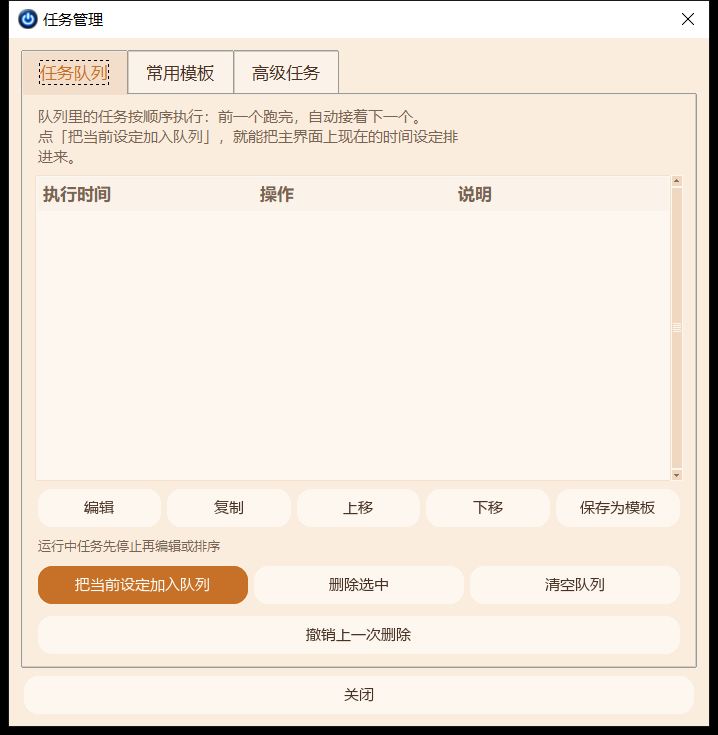
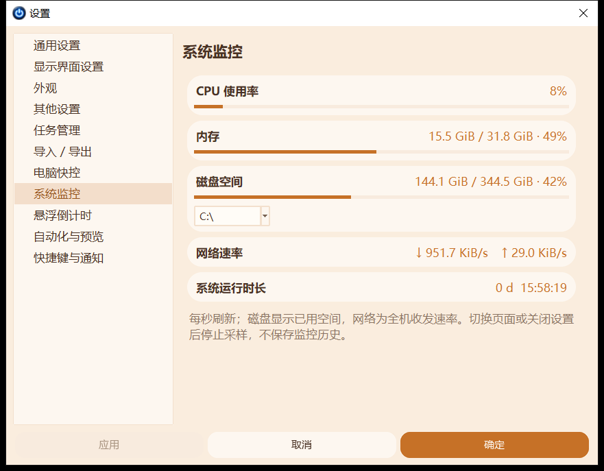
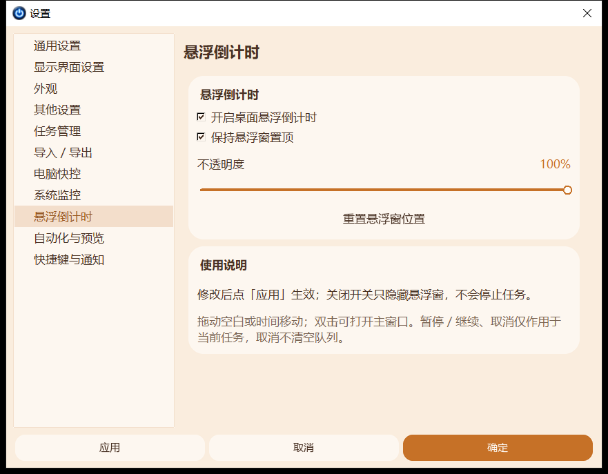

# 定时关机工具 · Shutdown-Tool

一个轻量的 Windows 桌面定时工具：选择操作、设定时间，即可完成关机、提醒、程序运行与程序强制结束等任务。支持托盘运行、任务队列、常用模板及条件预约，亮度、音量等辅助功能集中在设置里。

**当前公开版本：v1.7.4** · **作者：@wenhao** · **代码许可证：MIT**

> 从 v1.6.8 开始公开源代码。此仓库为当前维护版本的公开发行版：不附带内置音乐，播放声音时请自行选择本地音频文件。软件核心操作和定时能力保持。

[下载最新版](https://github.com/tugepaopao/Shutdown-Tool/releases/latest) · [使用说明](使用说明.md) · [构建说明](docs/BUILD.md) · [系统兼容](docs/COMPATIBILITY.md) · [报告问题](https://github.com/tugepaopao/Shutdown-Tool/issues)

## v1.7.4 更新亮点

- **奶油系界面**：暖色浅底、柔和圆角与简洁留白，八种主题会同时改变背景、选中状态、按钮和进度颜色。
- **一体式顶部栏**：设置、窗口置顶、最小化和关闭集中在顶部，窗口可拖动，主页固定紧凑尺寸，不支持自由缩放或上下滚动。
- **紧凑悬浮倒计时**：胶囊形小窗口，显示剩余时间并提供暂停/继续、取消；不在任务栏或 Alt+Tab 中单独占位。托盘右键可直接开关，也可在设置里调整透明度、置顶和位置。
- **设置按需加载**：缩短首次打开等待；各页面标题自然融入背景，保留清晰的功能分组。
- **细节修复**：处理拖动时的黑色残影、顶部空白、重复边框及按钮对齐；睡眠、休眠和今晚预设使用不同图标。

本版包含 v1.7.0～v1.7.4 经本地测试完善的界面更新，延续 v1.6.9 的计时、任务和设备控制能力。悬浮窗保留自由拖动，**没有吸顶折叠功能**。

## 界面预览


<details>
<summary>查看设置、任务管理与音频选择界面</summary>





</details>

## 下载：普通用户无需安装 Python

打开 [Releases 下载页面](https://github.com/tugepaopao/Shutdown-Tool/releases/latest)，在 Assets 中选择：

| 文件 | 用途 |
| --- | --- |
| `Shutdown-Tool-v1.7.4-Setup.exe` | 安装版，提供安装向导、快捷方式和卸载入口；推荐普通用户使用 |
| `Shutdown-Tool-v1.7.4-Portable.exe` | 单文件版，下载后双击运行，无需安装向导 |
| `Shutdown-Tool-v1.7.4-Source.zip` | 完整公开源码、资源、构建脚本及文档；面向开发者 |
| `Shutdown-Tool-v1.7.4-UserGuide.zip` | 使用说明、兼容说明及界面截图 |
| `SHA256.txt` | 上述文件的 SHA256 校验值 |

GitHub 的 **Code → Download ZIP** 下载的是源代码，不能替代可直接运行的 exe。安装程序和便携版请从 Releases 下载。

便携版的“便携”指无需安装：设置仍存放在当前用户的 `%APPDATA%\HaozaiziShutdownTool`，而不是 exe 同级目录。安装版与便携版共用该用户数据，采用单实例运行。升级前请保存安排，从托盘右键选择退出；仅点窗口右上角 × 通常会收进托盘。

## 系统要求

| 环境 | 状态 |
| --- | --- |
| Windows 10 x64 | 本机开发与实测环境 |
| Windows 11 x64 | 保持兼容设计，系统识别及接口回退已检查；尚未实机验证 |
| Windows 7 | 当前公开 exe 不支持；需要另做旧运行时构建 |
| macOS / Linux | 不支持，程序使用 Windows 专用接口 |

正式构建采用 Python 3.12.14 和 Tkinter。未提供原生 ARM64、32 位或 Win7 安装包；不要把源码语法可解析理解为二进制兼容。休眠、显示器亮度和通知能否使用，还取决于 Windows 设置、设备和驱动。详见 [兼容性说明](docs/COMPATIBILITY.md)。

## 能做什么

### 十种主页操作

| 操作 | 说明 |
| --- | --- |
| 关闭电脑 | 定时关机；执行前可按偏好提示确认 |
| 重启电脑 | 到点重新启动 Windows |
| 注销电脑 | 注销当前登录用户 |
| 锁定电脑 | 锁定当前 Windows 会话 |
| 进入睡眠 | 使用系统睡眠能力 |
| 休眠电脑 | 使用系统休眠能力，需系统支持并启用 |
| 关闭程序 | **按完整 exe 路径强制结束全部匹配实例及子进程**，包括托盘和后台进程 |
| 运行程序 | 到点启动所选程序 |
| 播放声音 | 播放用户自行选择的本地音频；公开版不附带音乐 |
| 弹出消息提示框 | 自定义文本，到点提醒 |

“关闭程序”会直接终止进程，未保存内容可能丢失，请先保存。选择目标程序的实际 exe，而非快捷方式或更新器；可从运行中窗口列表选择，或浏览 exe 文件。仅已收进托盘的程序也可按路径关闭。权限不足时会报告失败，可按需要以管理员身份运行工具；系统关键进程和本工具受到保护。外部守护程序可能重新启动目标，此时会报告仍有进程，而不会把请求已发送当作成功。

旧版“关闭显示器”已从主页移除，保留旧任务的查看能力，但不再执行该旧动作。

### 三种主页时间方式

| 方式 | 执行规则 | 示例 |
| --- | --- | --- |
| 倒计时 | 等待指定时长，执行一次 | 30 分钟后提醒 |
| 定点执行 | 在下一次所选星期和时刻执行一次 | 下一次周五 22:00 关机 |
| 循环间隔 | 按设定间隔重复执行 | 每 1 小时提醒喝水 |

“定点执行”不是每周重复；具体年月日、每日、工作日或周末重复，使用 **任务管理 → 高级任务**。倒计时和循环间隔的首次剩余时间可以相同，区别在于首次执行后是否继续循环。

快捷预设前五项固定：30 分钟、1 小时、2 小时、今天 18:00、今天 22:00。第六项可在设置 → 其他设置中选择今天、明天、后天或 3～7 天后，以及自定义时刻。

### 任务与自动化

- **任务队列**：添加、编辑、复制、上移/下移、删除；当前任务结束后顺序执行下一项。
- **常用模板**：命名保存常用设定，快速复用。
- **删除撤销**：队列和模板最近 20 次删除可在 5 分钟内撤销；退出后清空。
- **高级预约**：具体日期、每日、周一至周五、周末重复；支持今天跳过一次。
- **下载文件夹结束条件**：先观察文件活动，再等待持续安静；只检查目录直接文件。
- **网络安静条件**：监测全机网络收发量，先有活动，再持续低于阈值。
- **组合条件**：网络安静且当前 Windows 会话无人操作达到指定时间。
- **任务链**：启动前置程序，只有其退出码为 0 才执行后续动作；失败或超时停止后续任务。
- **未来 7 天预览**：展示已启用且时刻明确的预约，同一分钟的安排标注重叠。

高级任务保存后默认停用，需要手动启用。下载/网络安静不等于下载成功；程序退出或电脑睡眠时不会监控，也不会唤醒电脑。工作日仅指周一至周五，不调整法定节假日。任务链停用或超时不会强杀前置程序，重新打开工具后需手动重新启用。

### 日志、托盘与设置

- 执行日志搜索、事件筛选、日期筛选与 CSV 导出，最多保留 500 条。
- 托盘显示剩余时间，支持唤出、暂停、继续和延后。
- 到点前提醒支持取消执行、延后 5 / 10 / 30 分钟。
- 设置和任务模板 JSON 导入/导出；导入前预览，高级任务和全局快捷键不自动启用。
- 自动保留最近 10 份正常配置备份；配置损坏时尝试恢复，手动恢复前显示预览。
- 简体中文、繁体中文和英文；八种柔和主题色，固定浅色模式与标准字体。
- 可选全局快捷键：默认 `Ctrl+Alt+H` 唤出、`Ctrl+Alt+P` 暂停、`Ctrl+Alt+R` 继续；需在设置中启用。
- 可选 Windows 桌面通知：任务已设置、完成或失败；实际显示受系统通知及专注设置影响。
- 可选开机启动、退出时询问、恢复未完成倒计时等设置。

### 电脑快控（设置内）

自动检测连接的显示器，以主屏、副屏 1、副屏 2 等命名，支持独立或联动亮度调整；系统音量和静音控制当前默认播放设备。还可开启“防止电脑自动息屏”，阻止自动息屏和自动睡眠，退出工具后释放请求。

外接屏亮度通常需要显示器启用 DDC/CI，线材、转接器和驱动也需支持；不支持的设备会显示说明并禁用滑块。笔记本内置屏使用 WMI。常亮不拦截手动锁屏、手动睡眠、定时休眠、屏幕保护程序或锁屏策略。亮度、音量和常亮属于即时设置，点取消不会撤销已经生效的调整。

### 系统监控与桌面悬浮倒计时（v1.7.4）

**设置 → 系统监控**：每秒刷新CPU、内存、所选本地磁盘空间、全机上传/下载速率和系统运行时长。磁盘数据是空间占用，网络速率按实际采样间隔计算。离开此页或关闭设置停止采样，不保存监控历史。

**设置 → 悬浮倒计时**：默认关闭，可在设置开启后点应用，或从托盘右键直接切换。胶囊形小窗口不单独出现在任务栏或 Alt+Tab 中。显示当前任务的剩余时间，暂停/继续或取消当前任务；取消保留等待队列。支持40%～100%不透明度（默认100%）、置顶、拖动和记住位置、位置重置。主窗最小化或收进托盘仍可见；关闭开关只隐藏浮窗，不停止任务。没有计时任务时显示就绪，等待网络等高级条件时不会虚构倒计时。导入配置后默认关闭并重置跨设备位置。





## 第一次使用

1. 下载并运行安装版或便携版。
2. 在“选择操作”点击目标操作。运行程序、关闭程序、播放声音、消息提示卡片旁的 `…` 用于设置参数。
3. 选择倒计时、定点执行或循环间隔，填写时间；也可使用快捷预设。
4. 点击“开始”。底部状态卡显示剩余时间与预计执行时刻，圆环和横向进度条同步变化。
5. 暂停后可继续，停止用于取消当前任务；“立即执行”会真实执行所选动作，请先确认操作及参数。
6. 顶部齿轮菜单 → 任务管理，可切换任务队列、常用模板和高级任务页签；执行日志从齿轮菜单打开。
7. 不使用时，从托盘右键退出程序。只最小化窗口会继续运行计时。

建议首次用“弹出消息提示框 + 30 秒倒计时”熟悉流程，再使用电源或强制结束操作。

## 数据、隐私与备份

运行数据默认保存在 `%APPDATA%\HaozaiziShutdownTool`：

- 配置：`settings.json`
- 自动备份：`auto_backups` 子目录
- 日志与损坏配置备份：同一用户数据目录

工具的计时、日志和设备控制在本机处理；没有在线账号登录或云同步功能。此仓库与 Release 不包含开发者个人配置、历史日志或用户任务。导出的配置、日志可能包含你自行填写的程序路径和消息，请自行选择分享范围。

卸载前如需保留数据，请导出设置与模板。恢复和导入不会自动启动高级任务；公开版读取旧版的内置音频标识时不会寻找缺失音乐，请重新选择自己的音频文件。

## 开发与构建

项目使用 **Python + Tkinter** 构建桌面界面，直接调用 Windows API 完成电源、进程、通知和设备操作，使用 **PyInstaller** 打包单文件 exe，使用 **Inno Setup 6** 制作安装程序。

主要依赖：Pillow（图像与图标）、pystray（托盘）、psutil（进程/网络）、miniaudio/cffi（音频）；完整固定版本见 [requirements.txt](requirements.txt)。

在 Windows 上安装带 Tkinter 的 Python 3.12 x64，然后运行：

```powershell
git clone https://github.com/tugepaopao/Shutdown-Tool.git
cd Shutdown-Tool
py -3.12 -m venv .venv
.\.venv\Scripts\python.exe -m pip install -r requirements.txt
.\.venv\Scripts\python.exe src\main.py /m="测试提醒" /w
```

`/w` 表示只预选、不自动开始。也可以双击 `run_dev.bat` 启动源码界面。

构建便携版：

```powershell
.\.venv\Scripts\python.exe -m PyInstaller --noconfirm --clean --workpath build_work --distpath dist build.spec
```

构建安装版需额外安装 **Inno Setup 6.5+**，使用它的 `ISCC.exe` 编译 `installer\setup.iss`。完整路径、构建步骤与验证方法见 [BUILD.md](docs/BUILD.md)。预生成的图标已包含，可直接构建；重新生成图标属于可选操作。

### 源码结构

```text
Shutdown-Tool/
├─ src/                 程序源码
│  ├─ main.py           入口、DPI与单实例
│  ├─ ui_main.py        主界面与定时交互
│  ├─ ui_cozy.py        奶油风圆角控件与绘制
│  ├─ ui_titlebar.py    一体标题栏与窗口置顶
│  ├─ timer_engine.py   倒计时、定点和循环计时
│  ├─ actions.py        动作执行与命令行参数
│  ├─ program_control.py  按路径强制结束进程树
│  ├─ task_store.py     任务校验、模板和可移植备份
│  ├─ automation.py     条件任务与预约调度
│  ├─ pc_controls.py    亮度与系统音量接口
│  ├─ display_awake.py  屏幕常亮请求
│  └─ ui_*.py           设置、队列、日志等界面
├─ assets/              程序图标与界面资源，不含音频
├─ installer/           Inno Setup脚本与版本信息
├─ tools/               图标生成与回归检查
├─ docs/                构建、兼容、验证说明与截图
├─ build.spec           PyInstaller配置
├─ requirements.txt     固定依赖
├─ 使用说明.md          详细操作说明
├─ CHANGELOG.md         公开版本记录
├─ THIRD_PARTY_NOTICES.md  第三方组件说明
└─ LICENSE              MIT代码许可证
```

仓库不保存 exe、虚拟环境、构建缓存、旧版交接包、个人设置与历史测试截图；下载程序统一使用 Releases。

## 校验、问题反馈与贡献

下载后可在 PowerShell 中运行：

```powershell
Get-FileHash .\Shutdown-Tool-v1.7.4-Setup.exe -Algorithm SHA256
```

将结果与同一 Release 的 `SHA256.txt` 比对。开发测试说明见 [VALIDATION.md](docs/VALIDATION.md)，其他系统和设备的实际表现以现场验证为准。

遇到问题请提交 [Issue](https://github.com/tugepaopao/Shutdown-Tool/issues)，附软件版本、Windows 版本、复现步骤、预期与实际行为，界面问题可附截图。不要上传包含个人任务或路径的完整配置。欢迎通过 Pull Request 提交修复，涉及电源和进程终止的修改应提供隔离测试证据。

联系方式：**wenhao3843@gmail.com**

## 许可证

本项目第一方源代码采用 [MIT License](LICENSE)。第三方依赖和 Inno Setup 翻译文件沿用各自的许可证及署名，详见 [第三方说明](THIRD_PARTY_NOTICES.md)。公开版不包含内置音乐，也不授予任何第三方音频的使用权。
