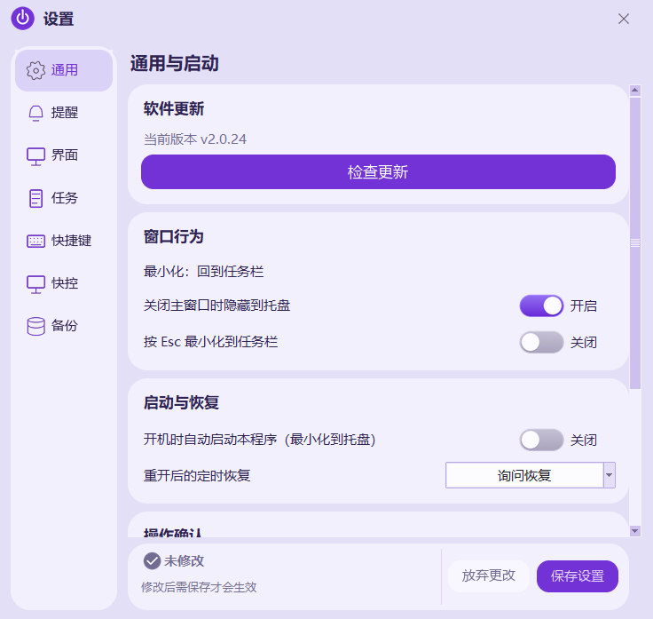
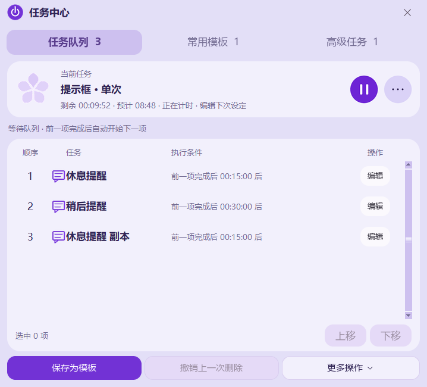
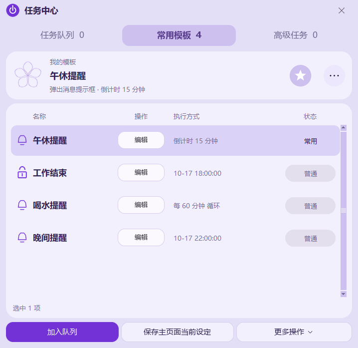
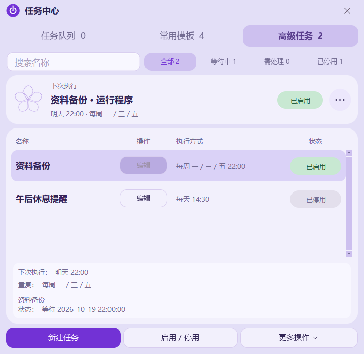
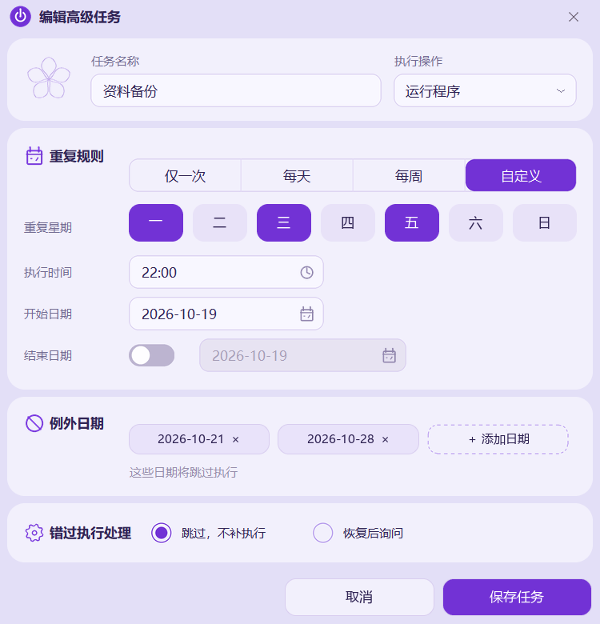
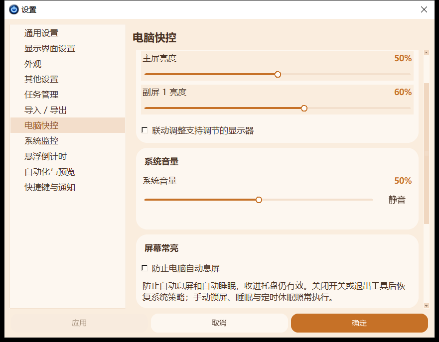

# 定时关机工具 v2.0.18 使用说明

一个轻量的 Windows 桌面定时工具。选择操作、设定时间，即可安排关机、消息提醒、程序启动或程序结束；任务队列、模板、高级预约和电脑快控集中管理。

**当前公开版：v2.0.18** · **作者：@wenhao** · **代码许可证：MIT**

[下载最新版](https://github.com/tugepaopao/Shutdown-Tool/releases/latest) · [使用说明](使用说明.md) · [构建说明](docs/BUILD.md) · [兼容说明](docs/COMPATIBILITY.md) · [反馈问题](https://github.com/tugepaopao/Shutdown-Tool/issues)

## v2.0.18 更新

本次公开版汇总 v2.0.12～v2.0.18 的主界面与输入体验改进，保留紫樱主题和原有任务功能。

- **更协调的窄版比例**：收紧左右边距，保持“选择操作、设定时间、运行状态”三个区域；星期与时间字号统一、略微缩小，文字颜色略淡。
- **重新整理时间区**：先选择计时方式并输入时间，再使用居中的快捷预设；六个预设按钮更加扁平，通栏紫色“开始”按钮突出主要操作。
- **透明时间输入**：数字与星期自然融入背景；点击数字可直接键入，支持小键盘、全选、删除和方向键。仅当前编辑的数字字段显示紫色三角提示。
- **星期选择更自然**：移除虚线焦点框，下拉菜单缩小并居中贴靠字段下方。
- **更稳定的模式切换**：预先绘制时间输入区域，减少首次切换倒计时、定点执行和循环间隔时的空白闪动；修复切换后点击及手动输入偶尔失效的问题。
- **清爽的标题栏**：任务中心独立为图标入口，设置、置顶等按钮融入背景且不显示悬停文字；修复设置菜单打不开的问题。
- **保留真实进度**：底部进度随活动任务推进，暂停保持进度，停止后重置。任务中心、预约恢复、日志、条件监控及任务期间保持唤醒功能继续保留。

公开版采用 MIT，不附带内置音乐，仍可选择本地音频。保留原安装身份和 APPDATA 数据目录。

## v2.0.11 累计改进（包含在本版）

- 保存预约交接记录：程序异常中断后，无法确认提交结果的预约需人工确认；重新加入后需手动开始。也可在高级任务“更多操作 → 处理中断预约”处理。已完成、已取消的预约不会自动重放。
- 命令结果区分“已提交”“未确认”和失败；执行前重新检查目标程序、音频、监控目录及休眠能力。
- 设置 → 电脑快控新增“任务期间保持电脑唤醒”。仅活动计时或条件监控时请求系统不自动睡眠，屏幕仍可熄灭；暂停计时、完成、取消和退出后释放。屏幕常亮开关独立生效。此功能不唤醒已经睡眠的电脑，也不阻止用户手动睡眠。
- 日历仅点击图标打开，重复点击图标或点击外部关闭；键盘 Enter/空格仍可打开。弹窗贴近图标，空间不足时向上或向内避让；取消不改日期，确定才保存日期。
- 完善自绘控件的键盘确认与焦点提示，滚动编辑区随键盘焦点滚动；菜单随所属窗口移动关闭，日历随所属窗口重新定位。
- 增加 Windows 显示、恢复和时间变化消息处理；长采样间隔不再当作已验证的网络安静时长。
- 后台空闲消息检查放缓、无活动预约时检查放缓，隐藏任务中心跳过刷新，共享采样取消可立即释放订阅。
- 安装版使用目录打包减少每次启动解包；便携版继续提供单 EXE。安装目录中的 `_internal` 是必需依赖，请勿单独删除。

## v2.0.10 累计改进（包含在本版）

- 统一处理原生下拉框与窗口焦点，覆盖页面切换、最小化、托盘隐藏和编辑弹窗。
- 界面刷新异常与调度异常分别记录，保留技术堆栈；同一持续错误合并计数。
- 睡眠恢复或时间前调跨过预约后，按错过策略处理；持久化预约消费标记，防止时间回拨重复执行。
- 保留原有 90 秒宽限：宽限内正常执行，超过宽限按跳过、恢复后询问或恢复后执行一次处理。多次错过合并一次，确认弹窗等待当前编辑结束。
- 模板及高级任务搜索采用 150 毫秒防抖；数据和选择未变时跳过重复列表及摘要更新。
- 多个网络或同目录监控共享原始采样，每项任务独立判断阈值，状态未变不重复通知。
- 日志批量检查裁剪，减少频繁写入时的整文件读取。

## v2.0.9 累计改进（包含在本版）

- 修复展开下拉框时，高级任务轮询将 Tk 原生 `popdown` 窗口误记为“高级任务检查失败”的问题。
- 高级任务本身的调度规则、启用状态和执行时间不受影响；历史日志继续保留。

## v2.0.8 累计改进（包含在本版）

- 执行日志采用摘要、圆角筛选卡片和列表卡片，底部三个按钮等宽排列。搜索自动筛选，时间、事件、内容和详情按列对齐；长内容省略，点击“查看”或双击可阅读并复制完整详情。
- 开始和结束日期直接点击选择，支持月份切换、点击月份标题选择月/年、今天、不限、取消和确定。紫色圆点标示端点，浅紫色标示筛选区间；开始/结束当天均包含。日期确认前不修改筛选值。
- 高级任务编辑也共用新日历，任务日期仍按原规则保存；例外日期保持原有添加/删除逻辑。
- 日志仅绘制可见行，连续输入合并筛选；内容未变化时保留选中项和滚动位置。超过30个模板或高级任务时，按可见区域创建行内控件。
- 减少重复页签刷新和标题栏配色遍历，设置页面完成初始配色后再显示。

以上改进继续包含在 v2.0.18 公开版。

## v2.0.7 更新

沿用 v2.0 紫樱界面，汇总 v2.0.5～v2.0.7 的窗口、调度与编辑体验改进。

- **统一任务编辑**：高级任务采用圆角卡片、连体重复方式选项、星期按钮、日期开关及可删除的例外日期标签；普通任务编辑保持同样风格。
- **灵活重复规则**：支持任意星期组合、例外日期和可选结束日期。错过预约默认跳过，也可选择恢复后询问或恢复后执行一次；多次错过合并为一次可取消的补执行。
- **搜索与状态筛选**：高级任务可按名称搜索，按全部、等待中、需处理、已停用筛选；筛选不改变实际调度顺序。名称过长时省略，选中后查看完整内容。
- **紧凑常用模板**：全部／收藏放入列表卡片左上角；达到8个模板时在右侧显示搜索。行内编辑与底部三个等宽按钮保持统一。
- **窗口与响应**：按点击顺序激活普通窗口，重复打开复用并恢复已有窗口；编辑弹窗保留模态保护。隐藏的悬浮窗和电脑快控减少无效刷新，页面按需创建。
- **按需诊断**：备份页展示调度、快捷键、悬浮窗和屏幕常亮状态，提供异常摘要、日志入口和备份恢复。
- **仅简体中文**：移除语言设置。旧英文、繁体中文配置及备份自动转为简体中文，保留原有任务与其他设置。

公开版采用 MIT，不附带内置音乐，仍可选择本地音频。保留原安装身份和数据目录。

## 界面预览


<details>
<summary>查看设置、任务中心、编辑窗口与悬浮窗</summary>












</details>

## 下载与升级

普通用户无需安装 Python。打开 [Releases](https://github.com/tugepaopao/Shutdown-Tool/releases/latest)，选择：

| 文件 | 用途 |
| --- | --- |
| `Shutdown-Tool-v2.0.18-Setup.exe` | 安装版：安装向导、快捷方式及卸载入口 |
| `Shutdown-Tool-v2.0.18-Portable.exe` | 单文件版：下载后直接运行 |
| `Shutdown-Tool-v2.0.18-Source.zip` | 公开源码、界面资源、构建脚本与文档 |
| `Shutdown-Tool-v2.0.18-UserGuide.zip` | 使用说明、兼容说明及截图 |
| `SHA256.txt` | 文件校验值 |

Code → Download ZIP 下载的是源码，可运行的 exe 请从 Releases 下载。

升级前请保存当前安排并从托盘退出旧版。v2.0 延续原公开版的安装身份和 `%APPDATA%\HaozaiziShutdownTool` 数据目录，可读取已有配置、模板及高级任务；安装版与单文件版共用同一用户数据并采用单实例运行。“便携版”指无需安装，配置仍存放在 APPDATA。

原个人定制版使用独立数据目录，不会自动覆盖其数据。如需迁移，可在旧版导出设置与模板，在 v2.0 导入；运行中的计时和队列不属于该导入范围。高级任务导入后保持停用，全局快捷键需手动启用。

## 系统要求

| 系统 | 当前状态 |
| --- | --- |
| Windows 10 x64 | 开发与实际测试环境 |
| Windows 11 x64 | 保持兼容设计，尚未实机验证 |
| Windows 7、macOS、Linux | 当前发行包不支持 |

运行时为 Python 3.12.14 + Tkinter，安装包最低 Windows 10；未提供原生 ARM64 或 32 位包。休眠、亮度调节和系统通知仍取决于 Windows 设置及设备驱动，详见[兼容说明](docs/COMPATIBILITY.md)。

## 主要功能

### 主页操作与时间

主页支持关闭电脑、重启、注销、锁定、睡眠、休眠、关闭程序、运行程序、播放声音和消息提示。

| 时间方式 | 行为 |
| --- | --- |
| 倒计时 | 等待指定时长，执行一次 |
| 定点执行 | 在下一次所选星期与时刻执行一次 |
| 循环间隔 | 按设定间隔重复执行 |

“定点执行”不是每周重复。具体日期、每日、工作日、周末等重复规则请使用任务中心 → 高级任务。六格预设在设置 → 任务中编辑；修改预设不会改变正在运行的任务。

底部状态区展示真实运行任务、单次／循环、预计执行时间和暂停状态。上方编辑新设定时，正在运行的任务仍单独显示。点击标题栏的任务中心图标可直接进入任务中心。

“关闭程序”按完整 exe 路径强制结束所有匹配实例及子进程，包括后台和托盘实例，可能丢失未保存内容。请先保存目标程序数据；权限不足时会报告失败。本工具及系统关键进程受到保护。

### 任务中心

- 等待队列：编辑、复制、上移／下移、删除、清空，前一项结束后开始下一项；Ctrl 点击可多选。
- 常用模板：命名保存、收藏、加入队列或再次编辑；新建、复制、删除和撤销位于“更多操作”。
- 撤销：队列和模板最近 20 次删除可在 5 分钟内撤销，退出后清空。
- 高级任务：具体日期、每日、任意星期组合、例外日期、可选结束日期，以及今天跳过一次。
- 条件任务：下载目录安静、全机网络安静、网络安静且无人操作，以及程序成功退出后执行后续动作。
- 未来 7 天预览：位于高级任务页的“更多操作”菜单，展示已启用、时刻明确的预约及同分钟重叠。

高级任务保存后需手动启用。错过预约默认跳过；若启用补执行，多次错过合并为一次，并保留10秒取消时间。超过结束日期不再补执行。下载或网络安静不等于下载成功；程序退出或电脑睡眠时不会监测，也不会唤醒电脑。工作日指周一至周五，不调整法定节假日。停用任务链不会强杀其前置程序。

### 编辑任务

执行操作下拉菜单中的“操作参数…”可编辑消息、程序路径、音频或强制关闭选项；选择需要参数的新操作时直接打开参数窗口。

高级编辑中点击“重复规则”标题可切换到下载、网络等高级执行方式；点击“错过执行处理”标题可查看全部策略。启用中的高级任务需先停用再编辑。

### 七个设置分类

| 分类 | 内容 |
| --- | --- |
| 通用 | 关闭与 Esc 行为、开机启动、恢复策略和操作确认 |
| 提醒 | 提前量、可取消提醒、提示音、消息停留、Windows 通知与预览 |
| 界面 | 悬浮倒计时开关、置顶、40%～100% 不透明度和位置重置 |
| 任务 | 六格预设编辑、排序、恢复默认和任务中心入口 |
| 快捷键 | 全局快捷键录入、注册状态、冲突提示及恢复默认 |
| 快控 | 显示器亮度、系统音量、静音、屏幕常亮及任务期间保持电脑唤醒 |
| 备份 | 导入／导出、自动备份、执行日志与诊断概要 |

界面仅支持简体中文，旧语言配置读取后自动转换。

普通设置修改后点击“保存设置”生效，未保存时显示修改状态。亮度、音量、屏幕常亮及任务期间保持唤醒立即生效，放弃设置不会撤销这些硬件调整。

### 全局快捷键

默认关闭，启用后使用：

| 操作 | 默认组合 |
| --- | --- |
| 唤出主窗口 | `Ctrl+Alt+H` |
| 暂停当前定时 | `Ctrl+Alt+P` |
| 继续当前定时 | `Ctrl+Alt+R` |
| 开启／关闭悬浮倒计时 | `Ctrl+Alt+F` |

点击组合键框后直接按新组合，支持 Ctrl／Alt／Shift 配合字母、数字或 F1～F12，至少包含 Ctrl 或 Alt。保存后注册；重复或被其他程序占用时保留原设置。

### 悬浮窗与提醒

悬浮倒计时默认关闭，也可从托盘或快捷键切换；可拖动、置顶、记住位置、暂停／继续和取消当前任务，不单独占用任务栏。没有计时时显示就绪，关闭浮窗不会停止计时。

执行前提醒默认提前 10 秒，可选 30 或 60 秒；提前提醒不改变任务执行时刻。“预览提醒”只演示弹窗，不启动真实任务。提醒中的延后 5／10／30 分钟操作会改变当前任务时间。

### 电脑快控

按主屏、副屏 1、副屏 2 自动识别显示器，支持独立或联动亮度。外接屏通常需要开启 DDC/CI；不支持的设备显示说明并禁用调节。音量与静音控制当前默认播放设备。

屏幕常亮阻止自动息屏和自动睡眠，退出后释放请求；不会拦截手动锁屏、手动睡眠或定时休眠。

## 初次使用

1. 选择“弹出消息提示框”，通过旁边的 `…` 填写消息。
2. 设置 30 秒倒计时，点击开始熟悉提醒流程。
3. 需要多项依次执行时，使用主页“加入队列”；在任务中心管理顺序。
4. 从齿轮菜单打开设置、任务中心或执行日志；这些窗口打开时主页面仍可操作，点击哪个普通窗口就激活哪个；主页面开启置顶时仍具有置顶优先级。
5. 不使用时从托盘右键退出。顶栏最小化回任务栏，关闭主窗口可按设置隐藏到托盘。

## 数据与隐私

运行数据保存在 `%APPDATA%\HaozaiziShutdownTool`，配置为 `settings.json`，备份在 `auto_backups`，执行日志最多保留 500 条，支持筛选和 CSV 导出。

计时、日志、设备控制在本机处理，没有云同步或在线账号。自动保留最近 10 份正常配置，配置损坏时尝试恢复；手动导入／恢复前有预览。默认诊断概要不包含消息和个人文件路径；导出的配置、日志可能含用户填写的内容，请按需分享。

## 开发与构建

项目使用 Python、Tkinter、Pillow、pystray、psutil、miniaudio/cffi；固定依赖见 [requirements.txt](requirements.txt)。

```powershell
git clone https://github.com/tugepaopao/Shutdown-Tool.git
cd Shutdown-Tool
py -3.12 -m venv .venv
.\.venv\Scripts\python.exe -m pip install -r requirements.txt
.\.venv\Scripts\python.exe src\main.py /m="测试提醒" /w
```

`/w` 仅预选，不自动计时。构建单文件版：

```powershell
.\.venv\Scripts\python.exe -m PyInstaller --noconfirm --clean --workpath build_work --distpath dist build.spec
```

生成 `dist/定时关机工具.exe`；使用 Inno Setup 6.5+ 编译 `installer/setup.iss` 可生成安装包。更多步骤见 [BUILD.md](docs/BUILD.md)，验证范围见 [VALIDATION.md](docs/VALIDATION.md)。

源码中的 `src/` 为程序逻辑，`assets/` 为界面资源，`installer/` 为安装脚本，`tools/` 为隔离回归工具，`docs/` 为构建、兼容、验证和截图。仓库不保存 exe、配置、日志、虚拟环境或历史交接包。

## 校验与反馈

```powershell
Get-FileHash .\Shutdown-Tool-v2.0.18-Setup.exe -Algorithm SHA256
```

与同一 Release 的 `SHA256.txt` 比对。遇到问题请提交 [Issue](https://github.com/tugepaopao/Shutdown-Tool/issues)，附软件版本、系统版本、复现步骤及预期／实际行为。联系方式：**wenhao3843@gmail.com**。

第一方源代码采用 [MIT License](LICENSE)，第三方组件说明见 [THIRD_PARTY_NOTICES.md](THIRD_PARTY_NOTICES.md)。公开版不附带内置音乐，也不授予用户选择的第三方音频使用权。
